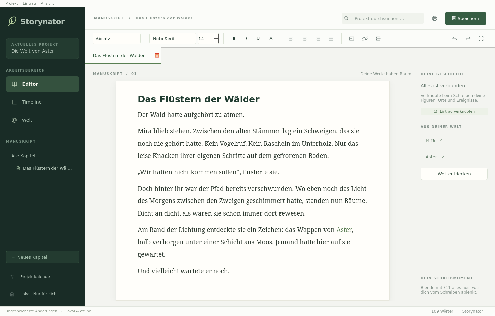
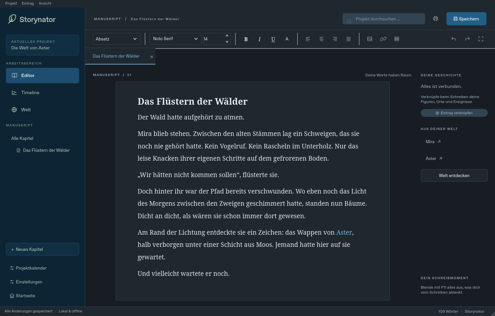

# Storynator

Eine lokal laufende Desktop-Anwendung zum Schreiben und zur Verwaltung einer Geschichtenwelt. Native Qt-Oberfläche mit Python/PySide6, ohne Webserver, Konten, Telemetrie oder Laufzeit-Netzwerkzugriffe.

## Direkt starten – Windows

**[Storynator-Setup.exe herunterladen](https://github.com/Burigames/storynator/releases/latest/download/Storynator-Setup.exe)**

Die Setup-EXE ausführen. Sie installiert Storynator für den aktuellen Windows-Benutzer, legt einen Eintrag für Startmenü und Windows-Suche an und registriert `.storynator` sowie `.storynator-preset`. Kein Python, keine weiteren Laufzeitinstallationen. Unterstützt wird Windows 10/11 x64. Bereits anderweitig gewählte Standardprogramme respektiert Windows; dann gegebenenfalls „Öffnen mit → Storynator“ wählen. Vorhandene Projektdateien bleiben bei Updates und Deinstallation erhalten.

Alternativ: **[Portable-Version](https://github.com/Burigames/storynator/releases/latest/download/Storynator-Portable.zip)** vollständig entpacken und `Storynator/Storynator.exe` starten. Die portable Version registriert keine Dateitypen. Der vollständige Ordner gehört zur Anwendung.

Die Anwendung wird als konventioneller Programmordner ohne EXE-Kompressor gebaut. Die Veröffentlichung prüft Tests, die gebaute EXE, eine echte Installation, Startmenü-Verknüpfung und Dateizuordnungen auf Windows. Prüfsummen stehen in `SHA256SUMS.txt` beim Release. **Die Anwendung ist aktuell nicht digital signiert.** Deshalb können Windows/SmartScreen weiterhin vor einem unbekannten Herausgeber warnen. Eine verlässliche Beseitigung solcher Herausgeberwarnungen benötigt ein vertrauenswürdiges Codesignatur-Zertifikat; Schutzfunktionen werden nicht umgangen oder abgeschaltet. Ein konkreter Virenfund muss mit Fundname und Datei separat geprüft werden.

### Für Entwickler

Quellcode: Python 3.11 oder neuer. `python -m venv .venv`, Umgebung aktivieren, `python -m pip install -r requirements.txt`, `python app.py`. Unter Windows stehen außerdem `Installieren.bat` und `Start-Storynator.bat` als Entwicklerhilfen bereit. Endnutzer benötigen diese Dateien nicht.

Der native Windows-Build erfolgt mit `python scripts/build_windows.py` nach Installation von `requirements-dev.txt`. Alternativ `Windows-EXE-bauen.bat`. Ergebnis: `dist/Storynator/Storynator.exe` mit Bibliotheken. Inno Setup 6 kompiliert `installer/Storynator.iss` zu `dist/Storynator-Setup.exe`. Der Workflow baut, testet und veröffentlicht Installer und Portable-ZIP.

## Das neue Schreibatelier

Neutrale dunkle Navigation, helle Papierfläche, zurückhaltende Symbolleiste und viel Raum für den Text. Editor, Timeline und Welt sind klar getrennte Arbeitsbereiche. Die Weltübersicht zeigt Kategorien als Karten; die Timeline zeigt schmale Zeitalter-Spuren über einem gemeinsamen Ereignisband. Die rechte Schreibhilfe öffnet Welt-Einträge, ohne das Kapitel zu schließen. Mit F11 lassen sich Navigation und Schreibhilfe für konzentriertes Schreiben ausblenden. Die Oberfläche folgt einem gemeinsamen Design in `design.py`, einschließlich Vektorsymbolen, Abständen, Farben und Dialogen.

## Neu in Version 0.4

- Timeline: schmale, überlappende Zeitalter oben; Ereignisse als Punkte darunter. Nahe Punkte werden nach Bildschirmabstand zu zählbaren Gruppen zusammengefasst. Klick öffnet eine getrennt auswählbare Ereignisliste. Zeitspannen bleiben als Linien unter dem Ereignisband sichtbar und anklickbar.
- Mausrad verkleinert/vergrößert den tatsächlichen Datumsbereich. Ziehen, horizontale Bildlaufleiste, Pfeile oder Umschalt+Mausrad verschieben ihn. „Alles zeigen“ setzt den Ausschnitt zurück. Achsenwerte stammen aus dem Projektkalender, auch vor dem Ursprung und ohne Jahr null.
- Welt-Einträge öffnen als vollständige, scrollbar lesbare Detailansicht. „Bearbeiten“ öffnet Felder, „Fertig“ kehrt zur Ansicht zurück. Änderungen werden unmittelbar Teil des Projekts; zum dauerhaften Speichern Strg+S verwenden.
- Akzentfarben gelten für alle UI-Hervorhebungen. Druck/PDF erhalten eine weiße Papierfläche, unabhängig vom Theme oder früher gespeicherten Absatzhintergründen.
- **Addon → Addons verwalten:** Vorlagen importieren, aktivieren/deaktivieren oder löschen. Das integrierte Weltenbau-Preset mit 14 Kategorien ist zunächst inaktiv. Aktivieren erzeugt ausschließlich Kategorien und Felder, niemals Einträge. Addons enthalten weder ausführbaren Code noch Eintragsdaten; das Format lehnt solche Inhalte ab.
- Deaktivieren blendet unbenutzte Preset-Kategorien aus. Kategorien mit eigenen Einträgen bleiben sichtbar, damit Inhalte erreichbar bleiben. Reaktivieren verwendet dieselben IDs. Löschen entfernt unbenutzte Vorlagen; benötigte Kategorien bleiben als eigene Kategorien erhalten.
- **Addon → Kategorien als Preset exportieren:** Kategorien auswählen; benötigte Quellkategorien werden automatisch mitgenommen. `.storynator-preset` enthält ausschließlich Vorlagen, keine Welt-Einträge, Bilder oder Beschreibungen aus Einträgen. Import fügt ein Preset zunächst inaktiv zur lokalen Bibliothek hinzu. Aktivierte Vorlagen reisen mit der Projektdatei mit.
- **Welt → Kategorievorlage → Feldeinstellungen:** Für Dropdown und Mehrfachauswahl unter „Auswahlquelle“ eine Kategorie wählen. Deren Einträge werden mit ihrem Namen angeboten; gespeichert wird die stabile ID. Umbenennen erhält die Verbindung. Bisherige freie Werte bleiben sichtbar, bis eine neue Auswahl getroffen wird.

## Neu in Version 0.3

- Listen, Verknüpfungsfelder und Tabellen haben Platz für mindestens vier Zeilen; lange Formulare und schmale Fenster scrollen als Ganzes.
- Die Formatleiste zeigt das tatsächliche Format am Cursor an, auch gebrochene Schriftgrößen. Neue Verweise und der Text danach übernehmen Schriftart, Größe und Hervorhebungen des umgebenden Texts. Die Formatierung bleibt beim Wiederöffnen und Umbenennen erhalten.
- Dropdowns und Zahlenfelder besitzen explizit gezeichnete Pfeile. Navigation und beschriftete Schaltflächen reagieren auf die ganze Zeile beziehungsweise Fläche.
- Unter **Einstellungen** sind Hell/Dunkel und fünf Akzentfarben wählbar: Wald, Ozean, Lavendel, Bernstein und Rose. Diese Änderungen wirken sofort und werden lokal gespeichert.
- Dort lässt sich die Oberfläche auf **Deutsch oder Englisch** einstellen. Die Sprache wird beim nächsten Start angewendet. Projektnamen, Inhalte, Kategorien, Feldnamen und Kalender bleiben unverändert. Standard-Schaltflächen und Qt-Druckdialoge werden ebenfalls übersetzt; native Systemdialoge folgen gegebenenfalls der Windows-Sprache.
- Beim Hover über Verweise, Navigationseinträge und Welt-Schaltflächen erscheint eine aktuelle Vorschau mit Namen, Kategorie, Beschreibung und ausgewählten Feldern.
- Druckeinstellungen werden im Projekt gespeichert; allgemeine Vorgaben gelten zusätzlich für neue Projekte. Kapitelnamen werden beim Drucken/PDF standardmäßig ausgegeben. Einzelne Kapitel erhalten ihren Namen als vorgeschlagenen PDF-Dateinamen.

## Erste Schritte

- Auf der Startseite Projekt erstellen oder `Beispiel.storynator` öffnen. Speichern mit Strg+S; Speichern unter mit Strg+Umschalt+S.
- **Editor:** Kapitel erstellen. Ein Klick auf die ganze Zeile in der linken Navigation öffnet Dokumente in Tabs. Text über die Werkzeugleiste formatieren. Bilder über „Bild“ importieren oder als Bild aus der Zwischenablage einfügen. Einfügen von fremdem Richtext übernimmt bewusst nur Text, um externe Bildpfade zu vermeiden.
- **Welt:** Kategorie erstellen; in der Vorlage beliebige Felder ergänzen und ihren Typ auswählen. Doppelklick auf „Einstellungen öffnen“ konfiguriert Dropdown-Optionen, Mehrfachauswahl oder Slider. Änderungen mit „Vorlage übernehmen“ bestätigen. Danach Welt-Einträge für diese Kategorie erstellen.
- **Verknüpfungen:** Im Text `@` eingeben, Namen suchen, Ergebnis doppelklicken. Im festen Feld „Verknüpfungen“ auf „@ Verknüpfen“ klicken. Links können auch Dokumente und Timeline-Einträge öffnen. Das Ausgangsdokument bleibt in seinem Tab mit seiner Schreibposition erhalten. Gleiche Namen werden durch Kategorie und Beschreibung unterschieden. Interne UUIDs werden nicht angezeigt.
- **Umbenennen:** Eintrag links auswählen und Menü „Eintrag → Umbenennen“ benutzen. Referenzen verwenden weiterhin dieselbe UUID und zeigen den neuen Namen. „Löschen“ warnt vor Verweisen; verbleibende Links erscheinen als gelöschte Einträge. Eine Kategorie mit Inhalten lässt sich nicht versehentlich mitsamt ihren Einträgen löschen.
- **Vorlagen ändern:** Felder umbenennen und mit ↑/↓ sortieren. „Archivieren“ entfernt die Anzeige, bewahrt aber alle Werte. „Aus Archiv“ stellt ein Feld mit seinen bisherigen Werten wieder her. Der Typ eines befüllten Feldes ist geschützt: Statt verlustreicher Konvertierung ein neues Feld anlegen.
- **Kalender:** „Projektkalender“ öffnen. Monate in Tabellenreihenfolge benennen, ihre Länge eingeben, Wochentage und Datumsdarstellung festlegen. Für reine Jahreszählung „Nur Jahreszahlen verwenden“ aktivieren. Beispiel für Darstellung: `{weekday}, {day}. {month} {year}`. Ohne Woche kann `{weekday}` entfallen.
- **Schaltregeln:** Alle n Jahre werden im angegebenen Monat zusätzliche Tage angehängt. Mit Versatz 1 und Intervall 4 gilt die Regel für Jahre 1, 5, 9 usw.; Versatz 0 gilt für 0, 4, 8 und negative Vielfache. Mehrere Regeln addieren ihre Tage. Es gibt keine Ausdrücke oder ausführbaren Skripte.
- **Timeline:** Datum als `Jahr/Monat/Tag`, zum Beispiel `-12/2/4`; beim Jahreskalender nur `-12`. Monat und Tag zählen ab 1. Leeres Ende bedeutet Zeitpunkt. Zeitalter benötigen Anfang und Ende. Überlappende Zeitalter sind erlaubt, auch mehrere Ereignisse am exakt gleichen Zeitpunkt. Optional ein übergeordnetes Zeitalter wählen; dann muss das Ereignis innerhalb seiner Grenzen liegen.
- „Timeline“ zeigt Liste und Zeitstrahl. Jede Position hat eine eigene auswählbare Spur. Strg+Mausrad zoomt, Ziehen verschiebt den Zeitstrahl. Nach Änderungen „Aktualisieren“ betätigen. Die Achse zeigt Tage beziehungsweise Jahre relativ zum Kalenderursprung; die Liste zeigt formatierte Daten.
- **Suche:** Suchtext oben rechts eingeben und Enter drücken. Ein Ergebnis per Doppelklick öffnen.
- **Sortieren:** Kapitel/Kategorie/Eintrag in der Navigation auswählen, Menü „Eintrag → Nach oben/Nach unten“.
- **Drucken/PDF:** Strg+P, Kapitel auswählen, Papier und Ränder einstellen, Druckvorschau öffnen oder direkt PDF exportieren. Kapitel beginnen im Export jeweils auf einer neuen Seite. Zusätzliche Seitenumbrüche lassen sich im Editor einfügen. Die zusätzliche Verknüpfungsfarbe entfällt beim Export; die ursprüngliche Schriftart, Größe, Farbe und Hervorhebung des Textes bleiben erhalten. Kapitelnamen erscheinen standardmäßig als Überschriften; dies lässt sich im Druckdialog abwählen. Papierformat, Ränder, Ausrichtung, Kapitelauswahl und weitere allgemeine Druckoptionen werden gespeichert. Beim PDF-Export eines einzelnen Kapitels wird sein Name als Dateiname vorgeschlagen.

## Speicherung und Sicherheit

`.storynator` ist ein ZIP-Archiv mit `project.json` (Formatversion 1) und `assets/`. Dokumente und formatierte Felder enthalten Qt-kompatibles HTML, Links `story:<UUID>` und Bilder `asset:<Dateiname>`. Keine ursprünglichen Bildpfade werden benötigt. Feld-IDs bleiben bei Umbenennung stabil; archivierte Werte bleiben im Projekt.

Speichern schreibt im Zielverzeichnis eine temporäre Datei, synchronisiert deren Inhalt und ersetzt die Zieldatei atomar. Ein Fehler vor dem Austausch lässt die letzte gültige Datei erhalten. Das ist keine Garantie gegen Hardwaredefekte oder alle Netzwerkdateisystemfehler; eigene Projektkopien bleiben sinnvoll.

Alle 30 Sekunden gibt es bei Änderungen eine lokale Wiederherstellungskopie im Qt-Anwendungsdatenverzeichnis (typischerweise `%APPDATA%/Storynator/`). Beim nächsten Start wird eine Wiederherstellung angeboten. Sie ersetzt kein bewusstes Speichern und enthält maximal den Stand des letzten Intervalls. Nach regulärem Speichern oder bestätigtem Verwerfen wird sie entfernt. Eine App-Instanz gleichzeitig verwenden: Die Wiederherstellungsdatei ist derzeit anwendungsweit.

## Technischer Aufbau

- `core.py`: Projektmodell, versionierter ZIP-Container, atomarer Austausch, eingebettete Ressourcen, UUID-Auflösung, Rückverweise, Kalenderarithmetik.
- `ui.py`: Mindestgrößen, vollständige Bedienflächen und explizite Dropdown-/Schritt-Pfeile.
- `i18n.py`: Offline-Sprachkatalog und Qt-Übersetzungen.
- `printing.py`: portable Druckeinstellungen und lokale Druckervorgaben.
- `design.py`: gemeinsames Gestaltungssystem und skalierbare Vektorsymbole.
- `scripts/build_windows.py`: einzelnes Windows-EXE-Paket; `.github/workflows/windows.yml`: Tests, Build, EXE-Prüfung und Release.
- `app.py`: Qt-Oberfläche, Richtexteditor, Kategorievorlagen und Felder, projektweite Suche, Tabs, Timeline, Kalenderdialog, Drucken/PDF.
- `test_storynator.py`: Integrationstests mit echtem Qt-Editor, Dateiarchiv und echtem PDF-Export.

Qt wurde gewählt, weil Richtext, Bilder, Undo/Redo, native Dateidialoge und plattformübergreifendes Drucken bereits robust vorhanden sind. Das Modell ist JSON-basiert und von der Oberfläche getrennt. Neue Feldtypen können mit `register_field_type(name, renderer)` registriert werden; der Renderer erhält `(window, entry, field)` und liefert ein Qt-Widget. Werte müssen JSON-kompatibel sein und Änderungen `window.changed()` melden. Unbekannte Feldtypen bleiben gespeichert und werden schreibgeschützt angezeigt.

## Prüfung

Entwicklungsabhängigkeiten: `python -m pip install -r requirements-dev.txt`. Danach `python -m pytest -q`. Ohne grafische Sitzung auf Linux: `QT_QPA_PLATFORM=offscreen python -m pytest -q`.

Geprüft wurden die Kategorienfelder Text/Bild/Dropdown/Slider, Charakter-Land-Verknüpfung, @-Einfügen im echten Texteditor, Umbenennen über die Oberfläche, eigener Kalender, überlappende Zeitalter und gleichzeitige Ereignisse, vollständiger Archiv-Roundtrip mit Bild, automatische Wiederherstellung, simuliertes Scheitern vor Dateiaustausch und PDF-Ausgabe mit neutralen Verknüpfungen sowie Kapitelumbrüchen.

## Noch vorhandene Grenzen

Dies ist eine funktionierende erste Desktop-Version, keine vollständig ausgereifte Word-Alternative.

- Windows-Start und EXE-Erzeugung werden im Release-Workflow geprüft. Physischer Druck auf realen Geräten sowie ein ausführlicher manueller Windows-Test stehen weiterhin aus.
- Kalender unterstützen frei benannte Jahre, beliebig viele Monate mit individueller Länge, Tage und optionale Wochen sowie reine Jahreszählung. Beliebige zusätzliche Hierarchiestufen (etwa Stunden oder mehrere verschachtelte Unterjahreseinheiten) sind noch nicht umgesetzt.
- Schaltregeln sind positive periodische Tageszusätze; Ausnahmeregeln wie „alle 100 Jahre nicht, außer alle 400“ haben noch keine eigene Darstellung. Der Ursprung liegt am ersten Tag des Ausgangsjahrs.
- Datumsfelder haben Texteingabe mit Validierung statt eines grafischen Datumspickers. Monatssortierung erfolgt über die Tabellenreihenfolge; die Monate werden von oben nach unten angelegt.
- Der Schreibeditor ist eine fortlaufende Schreibfläche; die paginierte Darstellung gibt es in der Druckvorschau. Keine Kopf-/Fußzeilen, Tabellenbearbeitung, DOCX-Import/-Export oder Rechtschreibprüfung.
- Formatierte Felder lassen sich über dieselbe Werkzeugleiste bearbeiten; Vorlagen haben noch keine visuelle Anordnung von Spalten oder Gruppen.
- Verknüpfungen besitzen keine Richtungstypen oder Graphansicht. Timeline-Liste und bestehende Welt-Verknüpfungslisten werden bei zwischenzeitlichen Änderungen gegebenenfalls durch Schließen und erneutes Öffnen aktualisiert.
- Es gibt noch keine separate Startseitenaktion zum Löschen alter Verlaufseinträge, keine Dateisperre für gleichzeitige Bearbeitung und keine mehrstufige Backup-Historie.
